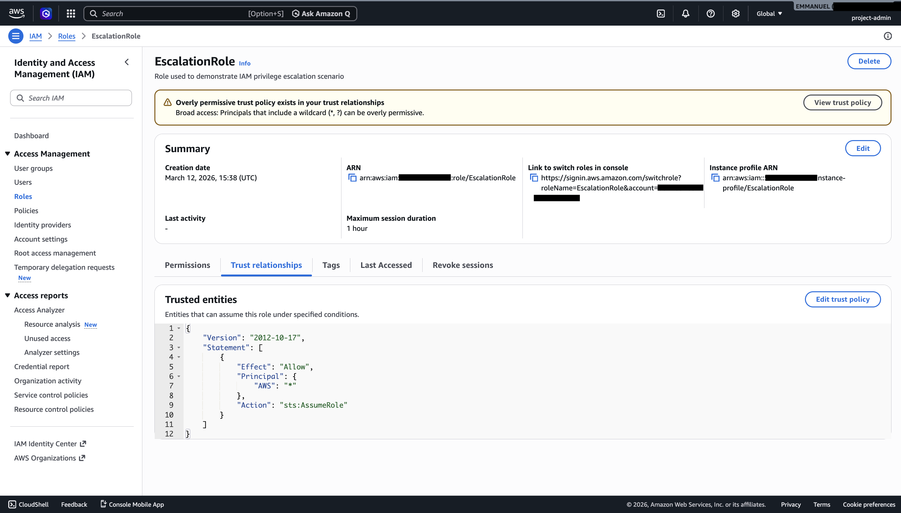
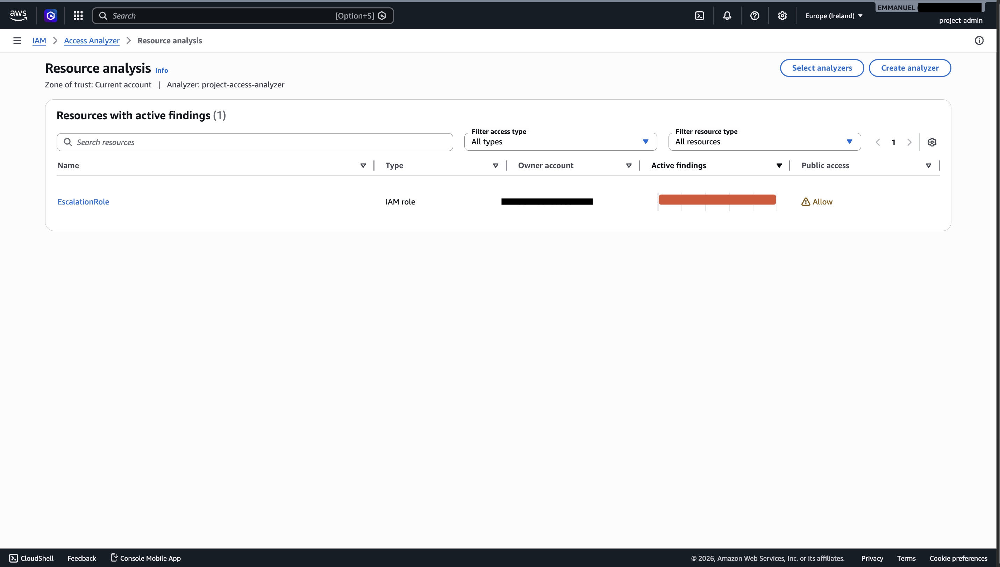
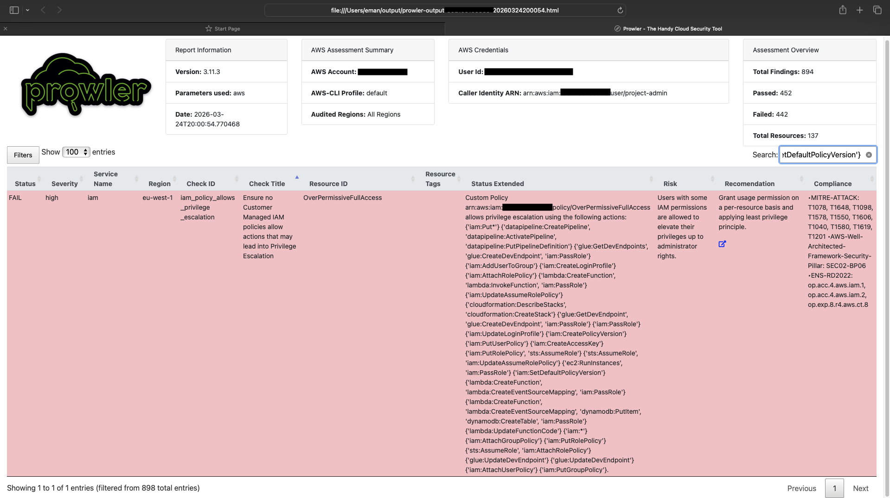
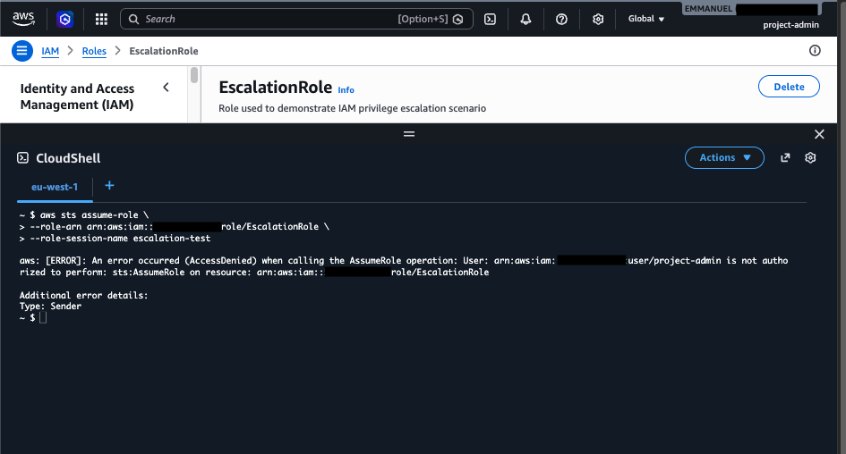

# AWS IAM Misconfiguration: Detection & Mitigation (Experimental Evaluation)

MSc Cybersecurity dissertation project, Coventry University (Distinction)

## What this project is about

IAM misconfigurations are one of the most common causes of cloud security breaches, but most of the tooling out there checks policies on paper rather than watching what happens when someone exploits them. I wanted to test that gap directly, so I built a live AWS environment, deliberately misconfigured it in a few realistic ways, then attacked my own setup to see which detection tools caught the exploitation as it happened, versus which ones only flagged the bad config sitting there unused.

I also built a small Python script on top of CloudTrail logs to see if a simple behavioural/runtime approach could outperform the established static-analysis tools. It did.

## The question I was testing

Most IAM misconfiguration detection is static policy analysis: does this policy look dangerous on paper? I wanted to know something more specific: when that dangerous policy gets exploited, which of these tools notices?

## Environment

Everything was built on AWS Free Tier:
- EC2 as the compute resource / attacker interaction point
- S3 as the storage target for access control and data exposure testing
- Lambda for cross-service permission testing
- IAM as the actual target (users, roles, policies, trust relationships)
- CloudTrail logging every API call across all regions, so I had a full trail of everything that happened

## Misconfigurations I introduced

| Misconfiguration | What it was | Impact |
|---|---|---|
| `OverPermissiveFullAccess` | A wildcard `Action: "*", Resource: "*"` policy | Full admin access |
| `S3WildcardAccess` | No restriction on which S3 buckets could be accessed | Data exposure |
| `EscalationRole` trust policy | `Principal: "*"`, literally any identity could assume this role | Unauthorised role assumption |
| Cross-service permissions | EC2/Lambda roles with far more access than they needed | Lateral movement |

## Attacking my own environment

1. Used `sts:AssumeRole` to exploit the open trust relationship and pull temporary elevated credentials
2. Confirmed the escalation worked with `aws sts get-caller-identity`
3. Used those elevated credentials to enumerate and access S3 buckets through the wildcard policy

Every step of this shows up in CloudTrail, which is what made the detection comparison possible.

## How the detection tools did

| Tool | Type | What happened |
|---|---|---|
| AWS IAM Access Analyzer | Native AWS | Caught the insecure trust relationship, but missed the actual escalation path |
| Prowler | Rule-based auditing (CIS benchmarks) | Best of the static tools, flagged both the excessive permissions and the escalation risk |
| ScoutSuite | Visual/multi-cloud auditing | Decent dashboard, moderate coverage, but didn't pick up the multi-step attack chain |
| My own script (Python, CloudTrail-based) | Runtime/behavioural | The only one that caught the actual `AssumeRole` exploitation as it happened |

That was the core finding: the static tools are useful for spotting bad configuration, but none of them noticed the configuration being exploited in real time. Only watching the logs did.

## Fixing it

- Removed the wildcard policies and replaced them with least-privilege, scoped permissions
- Locked the `EscalationRole` trust policy down to specific AWS services only
- Cut the EC2/Lambda roles back to only the permissions they needed
- Ran the exact same attack again afterwards. It failed with `AccessDenied`, which confirmed the fix held up in practice and not just on paper

| Security Aspect | Before | After |
|---|---|---|
| Privilege Escalation | Successful | Blocked |
| S3 Access | Unrestricted | Restricted |
| Trust Relationships | Open (`*`) | Secured |
| Detection Capability | Partial | Improved |

## What I took away from this

Secure configuration on its own isn't enough, and neither is static scanning on its own. The two need to be paired with continuous runtime monitoring (CloudTrail plus something watching behaviour) to catch misconfigurations that slip through, or that get exploited before anyone notices the policy was bad. That's the main argument of the dissertation, and probably the most useful takeaway for anyone running IAM in production.

## Evidence

Full lab record: [experiment-log.csv](experiment-log.csv)

**1. The misconfiguration: a trust policy open to any AWS identity**

**2. IAM Access Analyzer flagging EscalationRole as publicly accessible**

**3. Prowler flagging OverPermissiveFullAccess as a high-severity escalation risk**

**4. My CloudTrail script catching the AssumeRole escalation event**

**5. Same AssumeRole attempt after the fix: denied**

## Tools & technologies

AWS IAM, EC2, S3, Lambda, CloudTrail, AWS STS, Python, AWS CLI, IAM Access Analyzer, Prowler, ScoutSuite

## Full report

Happy to share the full dissertation on request. Feel free to connect with me on LinkedIn.
